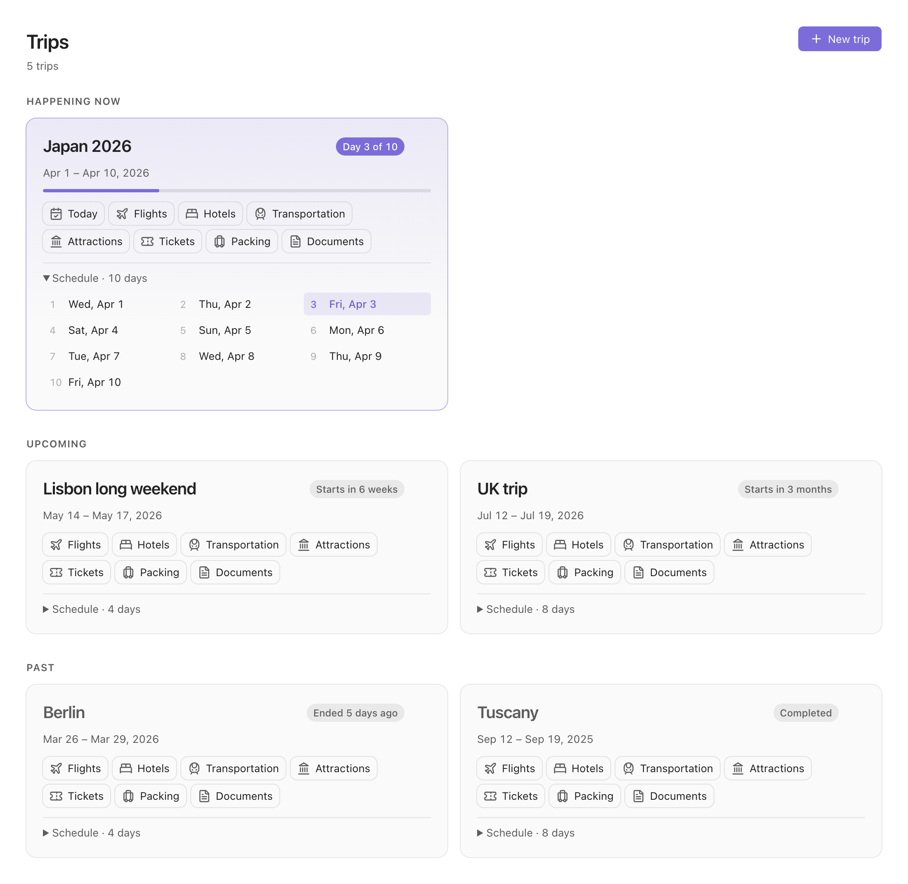
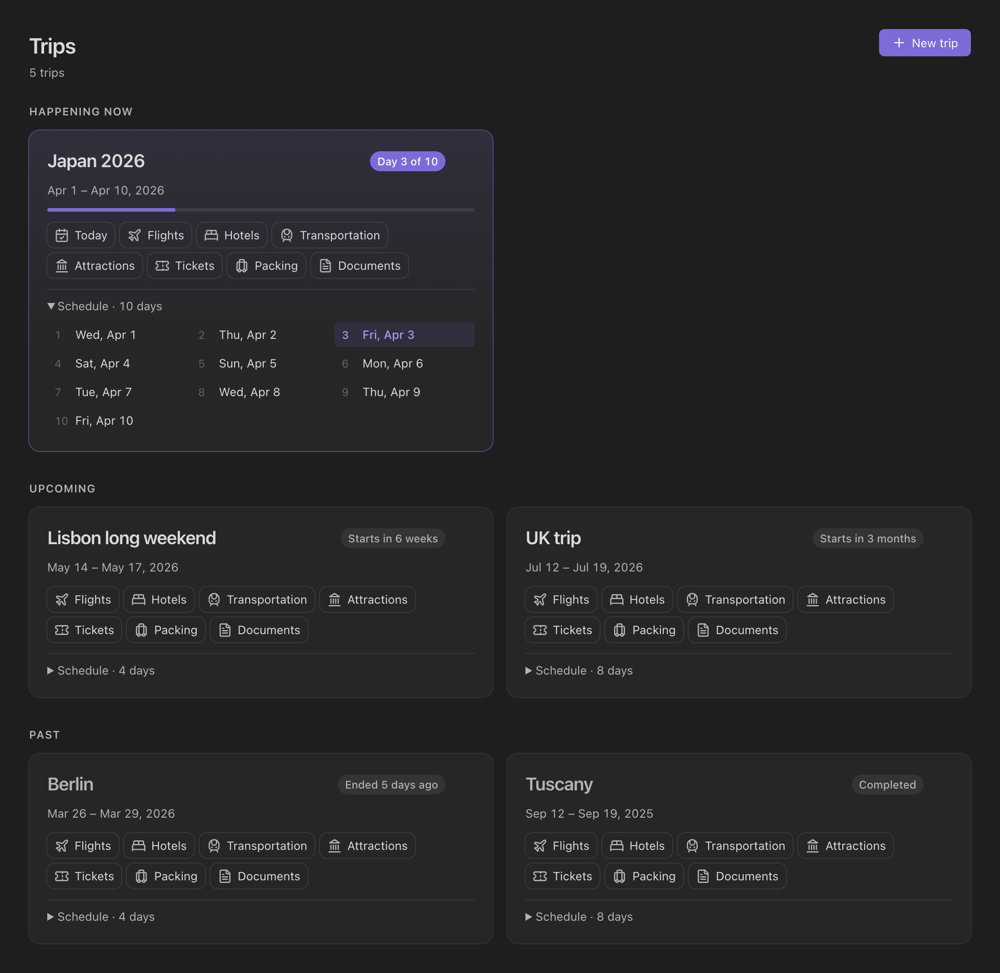
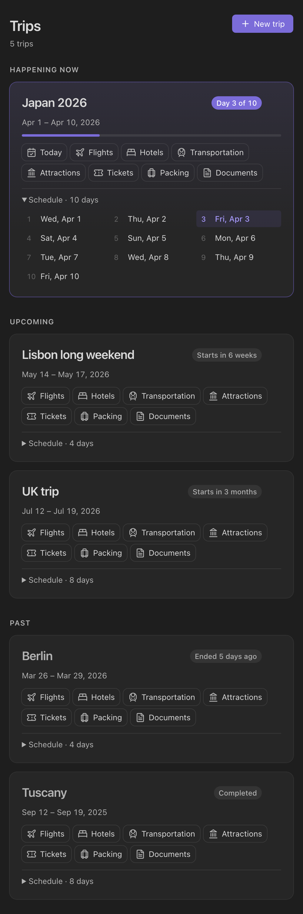
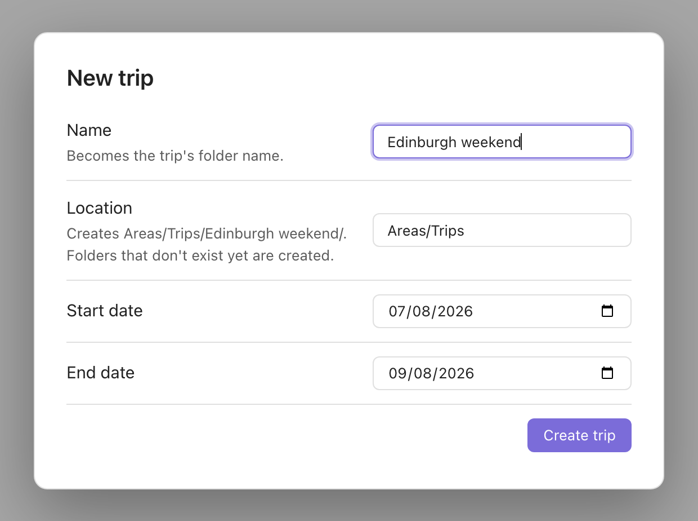
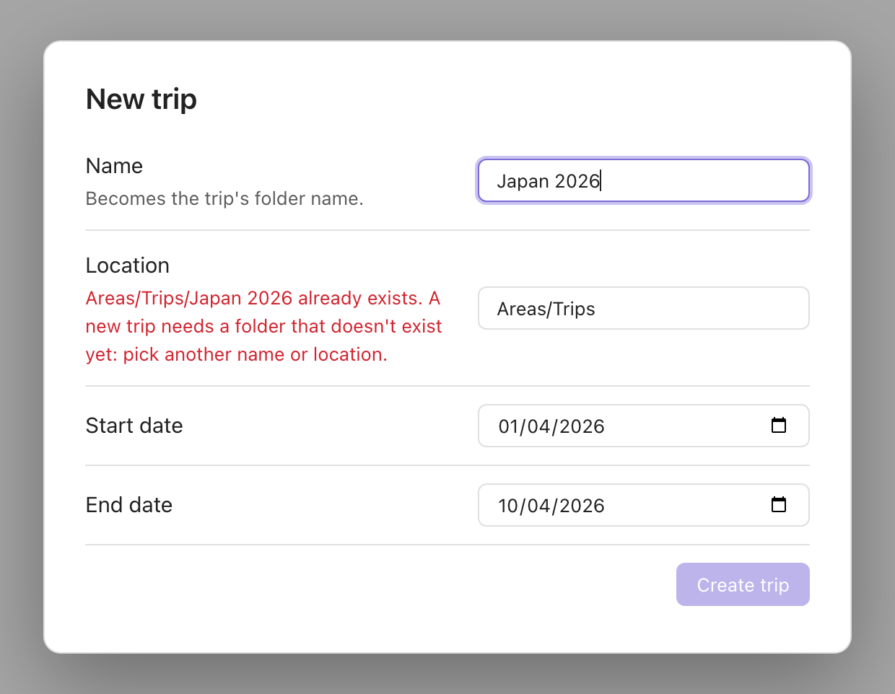
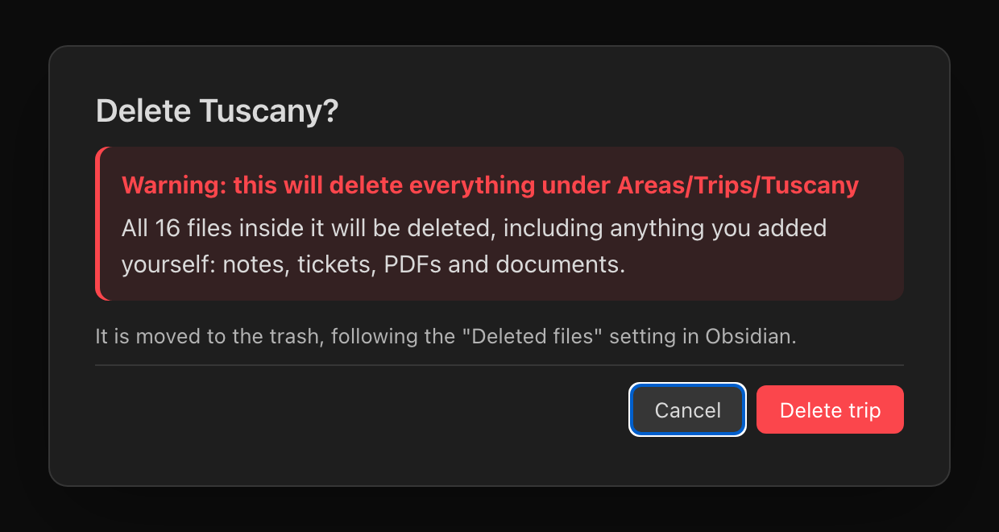

# Trip Planner for Obsidian

Create a tidy folder for every trip, and open any trip from one dashboard.



| Dark theme | Narrow pane or phone |
|---|---|
| [](docs/images/dashboard-dark.png) | [](docs/images/dashboard-phone.png) |
| Trips are grouped into happening now, upcoming and past. | The cards stack in a narrow pane. |

| New trip | Folder already taken | Delete |
|---|---|---|
| [](docs/images/new-trip.png) | [](docs/images/folder-exists.png) | [](docs/images/delete-warning.png) |
| Pick a name, any folder in your vault, and the dates. | A trip always gets a new folder; the form says so as you type. | Deleting warns that everything under the trip's folder goes. |

<sub>Screenshots are rendered from the plugin's own dashboard and dialog code and stylesheet in a browser, with a sample trip list and Obsidian-like theme colors, so spacing and colors in your theme will differ a little. Icons are [Lucide](https://lucide.dev) (ISC), the set Obsidian ships.</sub>

Give a trip a name, a location and dates and the plugin creates a folder for it there. With the name `Japan 2026` and the location `Areas/Trips` you get:

```
Areas/Trips/
  Japan 2026/
    Overview.md          dates, quick links, emergency and embassy numbers, the day list, a checklist
    Flights.md           outbound and return tables
    Transportation.md    getting around, airport transfers, passes and rentals
    Attractions.md       must-see places and monuments, opening hours, tickets
    Hotels/Index.md      where to keep booking confirmations, plus a table of stays
    Tickets/Index.md     tickets and confirmations, plus a list of them
    Packing/Index.md     a starter packing checklist
    Documents/Index.md   passports, visas and insurance (provider, policy number, emergency line)
    AGENTS.md            guide for AI agents: what to fill in where, and guardrails (see below)
    Schedule/
      2026-04-01 Wed.md  one note per day, with previous/next day links
      2026-04-02 Thu.md
      ...
```

`AGENTS.md` tells an AI agent (Claude Code, Codex and other tools that read it) how to fill each note, and sets guardrails: stay inside the trip folder, don't open PDFs, images or other attachments, don't read the files in `Documents/` (the `Index.md` there is fine to fill in, without ID or policy numbers) or copy sensitive numbers, and don't invent details, unless you explicitly allow it. The file has no `type` property, so the plugin ignores it.

Two limits to know:

- **It only helps if the agent reads it.** The file sits in the trip's folder, so start your agent in that folder (or tell it to read `AGENTS.md` first). An agent started at the vault root may never see it, and tools differ in whether they pick up a nested `AGENTS.md`.
- **It is a request, not access control.** For a hard guarantee, also set deny rules in your agent's permission settings, for example deny reading `**/*.pdf` and `**/Documents/**`.

Trips created before this feature have no `AGENTS.md`. Hover the trip's card and click the robot icon to add one; it never overwrites an existing file, and only works on trips that own their folder (the same rule as delete).

The **Trips** page lists every trip in the vault, wherever its folder is: *Happening now*, *Upcoming* and *Past*, each with its dates, a countdown ("Day 3 of 10", "Starts in 12 days") and quick links to today's note and every section (flights, hotels, transportation, attractions, tickets, packing, documents) and every day; the trip title opens its overview. Ctrl/Cmd-click or middle-click a link to open it in a new tab.

## Using it

- Click the plane icon in the ribbon, or run **Open trips** from the command palette, to open the dashboard.
- Click **New trip**, or run **Create new trip**, to scaffold a trip. The **Location** field suggests your vault's folders; folders that don't exist yet are created. It starts with your default location. A trip always gets a new folder: if `location/name` already exists (ignoring letter case, as macOS and Windows do), the form says so as you type and blocks **Create trip** until you pick another name or location.
- To delete a trip, hover its card and click the trash icon (it is always visible on touch screens). After a confirmation that warns it will delete everything under the folder (with the number of files, including any you added yourself), the trip's whole folder moves to the trash, following your Obsidian "Deleted files" setting. Only a trip that owns its folder can be deleted this way: the folder must hold just that trip (no other trip beside or inside it), with the `Overview.md` this plugin creates. Trips you wrote by hand into a shared folder are listed but have no delete button, so a delete can never take unrelated notes with it.
- Notes carry a `type` property (`trip`, `trip-day`, and `trip-flights`, `trip-hotels`, `trip-transportation`, `trip-attractions`, `trip-tickets`, `trip-packing`, `trip-documents`) and the overview has `start` and `end`. The dashboard finds trips by those, so you can rename notes, add your own, or write a trip by hand. A note belongs to the nearest trip folder above it, so trips can be nested. Query them with Bases or Dataview if you like.

## Settings

| Setting | Default | |
|---|---|---|
| Default location | `Trips` | The folder the new trip form starts with. Each trip can go somewhere else; the dashboard finds trips anywhere. |
| Open overview after creating | on | |

## Development

```bash
npm install
npm test        # domain, application, adapter, UI (view, modals, settings tab, plugin entry) and architecture tests
npm run test:coverage   # the same with a coverage report
npm run dev     # watch build of the plugin (main.js)
npm run build   # type-check + tests + production build (fails past the main.js size budget)
npm run lint    # Obsidian's plugin-review rules + the layering rules
npm run check:licenses   # what ships in main.js, and the licenses of everything installed
```

### Architecture

Domain-driven design with ports and adapters, as in [obsidian-brain-graph](https://github.com/davidpeled/obsidian-brain-graph). Imports only point inwards. See [`architecture/service-trip-planner.md`](architecture/service-trip-planner.md).

```
src/
  bootstrap/        composition root: container.ts (shared with tests), plugin.ts (Obsidian entry)
  domain/
    contracts/      trip, settings
    interfaces/     outbound ports: TripVaultRepository, WorkspaceGateway, SettingsRepository, Clock
    model/          pure rules: dates, trip scaffold (what to create), trip discovery (what exists)
  application/
    services/       use cases: create and list trips, settings
    controllers/    what the UI talks to
    mappers/        the dashboard read model
  infrastructure/
    obsidian/       adapters for Obsidian's API, the dashboard view, the new-trip modal, the settings tab
    in-memory/      twins of the ports, used by the tests (same contract spec as the Obsidian adapter)
    system/         the clock
```

`src/architecture.spec.ts` and the ESLint config enforce the layering: nothing imports outward, `obsidian` is confined to its adapters, and domain and application code never touch the DOM.

### Installing into a local vault

```bash
npm run link:vault -- /path/to/vault   # development: relative symlink to this repo
npm run deploy -- /path/to/vault       # real copy of main.js, manifest.json, styles.css
```

### Releases

Every push to `main` runs lint, tests and the build, tags the next patch version and publishes a GitHub release with `main.js`, `manifest.json` and `styles.css` (see `.github/workflows/release.yml`).

The release version is written into `manifest.json` (and `package.json`, `package-lock.json`, `versions.json`) by `scripts/bump-version.mjs`, in a release commit that is tagged but not pushed to `main`; the tag is the source of truth. Two checks use `scripts/check-version.mjs` to make sure Obsidian never sees a manifest that disagrees with its tag: one before tagging (every version file carries the release version), and one after publishing that downloads the `manifest.json` asset from the release itself and checks that. Either failing stops the release with a message naming the file. To ship a new minor or major, set the version in `manifest.json` and `package.json` above the latest tag; patch numbering continues from it. `src/release.spec.ts` tests both scripts.

## License

[MIT](LICENSE) © 2026 David Peled

The release file `main.js` contains only this project's own code: no third-party package is bundled into it (Obsidian provides its own API at runtime), so there are no third-party license notices to carry. The packages installed for building and testing (never shipped) are all permissive (MIT, ISC, BSD, Apache-2.0, 0BSD, BlueOak), apart from two dev-only exceptions that are not redistributed: `argparse` (Python-2.0) and `eslint-plugin-no-unsanitized` (MPL-2.0, file-level copyleft). `npm run check:licenses` enforces this, and CI runs it, so a new dependency with a different license fails the build until someone decides.

## Code of conduct

This project follows the [Contributor Covenant](CODE_OF_CONDUCT.md). By taking part you agree to abide by it.
